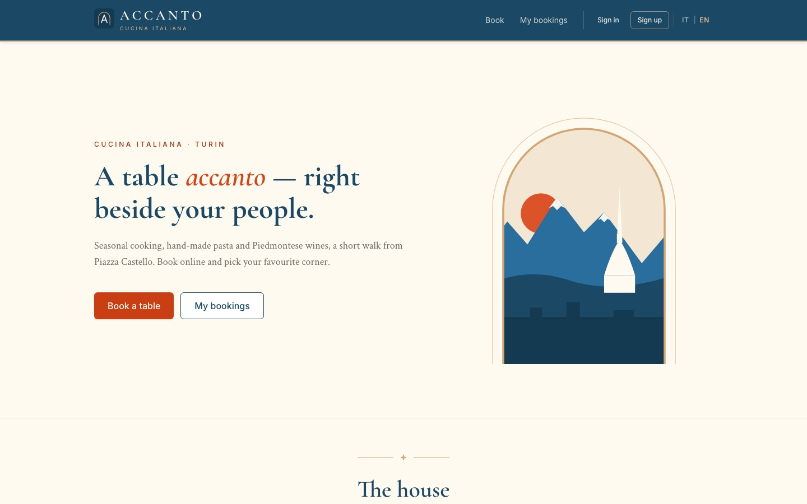

# Accanto · Reservation system

Accanto is a bilingual (Italian / English) table reservation system for a fictional Italian restaurant in Turin. Guests check live availability, book a table and manage their bookings. Staff run tables, opening hours, reservations, customers and reports from an admin panel.

**Live:** <https://accanto-psi.vercel.app>

[](https://accanto-psi.vercel.app)

**Stack:** Next.js 16 (App Router, Cache Components) · React 19 · TypeScript · PostgreSQL + Prisma 7 · Zod · Tailwind CSS 4 · SWR · Nodemailer · Vitest · Vercel

## Features

- **Live availability** by date, party size and seating area. The list refreshes every 30 s.
- **Four-step booking.** The selection lives in the URL, so it survives sign-in or sign-up. Each booking gets a unique code (`ACC-XXXXXX`).
- **My bookings.** Guests change date, time or party size and cancel. If their table is no longer free, another one is assigned.
- **Admin dashboard.** Live table status, a daily agenda (tables × hours), occupancy charts, customer notes and change history.
- **Reports.** Occupancy, estimated revenue, frequent guests, cancellations and no-shows, with CSV export.
- **Emails** through a queue: confirmation, change, cancellation and 24 h / 2 h reminders, in the guest's language.
- **Full i18n.** Every page lives under `/it/...` or `/en/...`. The English dictionary is type-checked against the Italian one.
- **Security.** CSRF checks, rate limiting, CSP and protection against double bookings.

## Requirements

- Node.js 20.9 or later (the minimum for Next.js 16).
- PostgreSQL 14 or later. For local work, `prisma dev` (included) runs one without Docker.

## Setup

```bash
npm install                          # also generates the Prisma client
npm run db:start                     # local Postgres; prints its URL
cp .env.example .env.local
```

Edit `.env.local`:

- `DATABASE_URL`: the URL printed by `db:start`.
- `DATABASE_POOL_MAX="1"`: the `prisma dev` database accepts one session only.
- `AUTH_SECRET`: run `openssl rand -base64 32`.
- `CRON_SECRET`: run `openssl rand -hex 16`.
- `EMAIL_HOST=""`: leave it empty to print emails to the console.

Then create the tables and load the test data:

```bash
npx prisma migrate deploy            # applies the migrations
npm run db:seed                      # loads the test data
npm run dev                          # http://localhost:3000
```

With your own PostgreSQL, put its URL in `DATABASE_URL`, skip `db:start` and leave `DATABASE_POOL_MAX` empty. [docs/SETUP.md](docs/SETUP.md) has more detail.

### Test accounts

These come from the seed and only exist in development.

| Role   | Email                   | Password         |
| ------ | ----------------------- | ---------------- |
| Admin  | `admin@accanto.local`   | `AdminPass123!`  |
| Client | `client1@accanto.local` | `ClientPass123!` |
| Client | `client2@accanto.local` | `ClientPass123!` |

The admin panel is at `/it/admin/login` (or `/en/admin/login`).

The seed creates:

- **Opening hours:** Thursday to Sunday, lunch 12:00–15:00 and dinner 18:00–23:00. Closed Monday to Wednesday.
- **Booking length:** 2 h.
- **12 tables:** 1–4 indoors (4 seats), 5–8 terrace (4 seats), 9–10 private room (8 seats), 11–12 VIP by the window (2 seats).
- **16 reservations:** 9 in the coming weeks and 7 in the last two weeks, with attended, no-show and cancelled states.

## Environment variables

See [.env.example](.env.example) for the format.

| Variable                                                   | Required | Purpose                                                                                                  |
| ---------------------------------------------------------- | :------: | -------------------------------------------------------------------------------------------------------- |
| `DATABASE_URL`                                             |   Yes    | PostgreSQL connection string used by the app.                                                            |
| `DATABASE_URL_UNPOOLED`                                    |          | Direct connection for migrations and the seed. Falls back to `DATABASE_URL`.                             |
| `DATABASE_POOL_MAX`                                        |          | Connections per server instance. Use `1` with `prisma dev`. Default: 5 in production, 10 in development. |
| `AUTH_SECRET`                                              |   Yes    | Signs the session JWT. At least 32 characters.                                                           |
| `APP_URL`                                                  |   Yes¹   | Public base URL, used for links in emails.                                                               |
| `CRON_SECRET`                                              |   Yes    | Bearer token for `GET /api/emails` (reminders and email queue).                                          |
| `RESEND_API_KEY`                                           |          | Sends email through Resend. Takes priority over SMTP.                                                    |
| `EMAIL_HOST`, `EMAIL_PORT`, `EMAIL_USER`, `EMAIL_PASSWORD` |          | SMTP settings for Nodemailer, used when there is no Resend key.                                          |
| `EMAIL_FROM`                                               |          | Sender name and address.                                                                                 |
| `ADMIN_NOTIFICATION_EMAIL`                                 |          | Recipients of staff alerts, comma-separated.                                                             |
| `ADMIN_EMAIL_LOCALE`                                       |          | Language of staff alerts: `it` (default) or `en`.                                                        |
| `DEMO_MODE`                                                |          | `true` shows the test accounts on the login screens in production.                                       |
| `EMAIL_RECIPIENT_ALLOWLIST`                                |          | Only send email to these addresses or `@domains`. Recommended for public demos.                          |

¹ On Vercel it defaults to the project's production domain.

With no Resend key and no `EMAIL_HOST`, emails are printed to the server console.

## Tests and scripts

```bash
npm test             # unit tests, plus integration tests when DATABASE_URL is set
npm run typecheck    # TypeScript
npm run lint         # ESLint
npm run dev          # development server
npm run build && npm start   # production build
```

Integration tests need the seed loaded. Skip them with `SKIP_DB_TESTS=1 npm test`.

| Script                         | What it does                                                      |
| ------------------------------ | ----------------------------------------------------------------- |
| `npm run format`               | Prettier.                                                         |
| `npm run db:start` / `db:stop` | Starts or stops the local `prisma dev` database.                  |
| `npm run db:migrate`           | Creates a migration after a schema change (`prisma migrate dev`). |
| `npm run db:seed`              | Reloads the test data. **Deletes** reservations and tables.       |
| `npm run db:reset`             | Drops the database, reapplies migrations and seeds it.            |
| `npm run db:studio`            | Opens Prisma Studio.                                              |

## Project structure

```
prisma/            schema, migrations, seed
emails/            HTML email layouts ({{variable}}, {{#block}}…{{/block}})
src/
  app/
    [lang]/        every page, per language (it | en)
      (auth)/      login, register, logout
      (client)/    reserve, my-reservations, profile
      admin/       login, unauthorized, dashboard/*
    api/           REST API (no language prefix)
  i18n/            language config, it/en dictionaries, translation helpers
  components/      UI: common, auth, reservations, admin, profile, home
  hooks/           useAuth, useAvailability, useReservations, useTables, useAsync
  lib/             db, auth, session, validation (Zod), scheduling, email, helpers
  services/        business logic; the only layer that talks to the database
  types/           shared DTOs
  proxy.ts         route protection and Origin checks (formerly "middleware")
tests/             unit/ (pure logic) and integration/ (against the database)
docs/              SETUP, API, ARCHITECTURE
```

## Data flow

A booking, from search to email:

1. The guest picks a date and party size. `useAvailability` calls `GET /api/reservations/availability` every 30 s.
2. `availabilityService` reads opening hours, tables and existing bookings. `lib/scheduling.ts` works out the free slots.
3. The guest confirms. `POST /api/reservations` validates the body with Zod and calls `reservationService`.
4. In one transaction, the service locks the service day, checks the table is still free, saves the booking and its history, and queues the emails as `PENDING` rows in `EmailLog`.
5. After the response is sent, `after()` delivers the queued emails. The cron call to `GET /api/emails` queues reminders and retries failures, up to 3 times.

[docs/ARCHITECTURE.md](docs/ARCHITECTURE.md) explains the layers and the design decisions.

## Deployment

Production runs on Vercel (functions in `fra1`) with a Neon Postgres database in Frankfurt. [docs/SETUP.md](docs/SETUP.md#6-deployment-vercel) lists the exact steps. After the first setup, every push to `main` deploys and applies pending migrations.

- **Public demo:** the test accounts only show with `DEMO_MODE=true`. In production the seed requires your own passwords (`SEED_ADMIN_PASSWORD`, `SEED_CLIENT_PASSWORD`). If real emails go out, set `EMAIL_RECIPIENT_ALLOWLIST` so nobody can use your domain to write to strangers.
- **Reminders:** Vercel Hobby only runs crons once a day, so `vercel.json` has a daily fallback. The 2 h reminders need a more frequent call. The workflow `.github/workflows/email-cron.yml` calls the endpoint every 15 minutes. It needs the `APP_URL` and `CRON_SECRET` repository secrets.

## Extending

- **Booking rules** (length, slots, booking window): set them in the admin panel. The logic is in `src/lib/scheduling.ts`, which is pure and tested.
- **New email type:** add the value to `EmailTemplate` in the schema, add the layout to `emails/` and register it in `TEMPLATE_FILES` (`src/lib/email.ts`). Then queue it from `emailService`.
- **New endpoint:** put the Zod schema in `lib/validation.ts` and the logic in a service. Wrap the route in `handle()` and use `requireApiUser` or `requireApiAdmin`.
- **New language:** add the code to `locales` in `src/i18n/config.ts`. Create `src/i18n/dictionaries/<code>.ts` typed as `Dictionary`. TypeScript flags every missing key.
- **Design system:** the "Mediterraneo" brand guide is in `src/app/globals.css`. It has brand colours (`--mediterranean-blue`, `--terracotta`, `--olive`…) and semantic tokens for components (`bg-surface`, `text-primary`, `bg-accent`…). Fonts: Cormorant Garamond (headings), Crimson Text (body) and Inter (UI). Tailwind 4 has no `tailwind.config.ts`: the theme is defined with `@theme` in that file.
- **Ideas for v2:** payments and deposits, a waiting list, reviews and multiple restaurants. Every entity already has a `restaurantId`.

The REST API is documented in [docs/API.md](docs/API.md).
